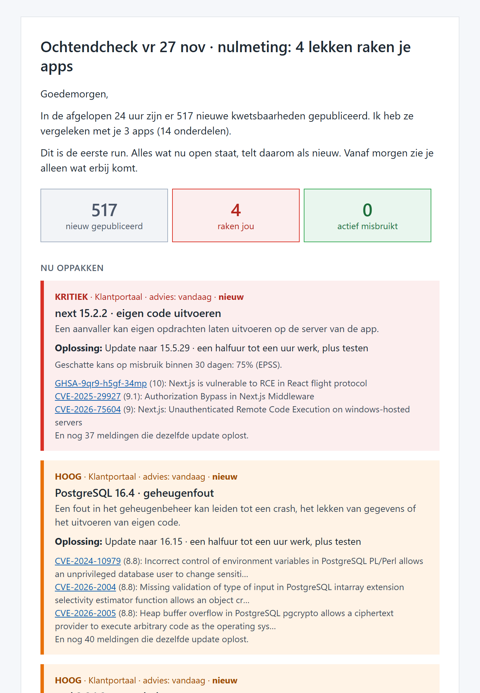

# Kwetsbaarheden-radar

Elke ochtend één mail: welke nieuwe kwetsbaarheden raken jouw apps, hoe erg is
het en welke update lost het op.

Een app die je met Claude, Lovable of een bureau hebt laten bouwen, bestaat uit
honderden onderdelen van anderen. In die onderdelen worden elke dag nieuwe
lekken gevonden. De radar legt de onderdelen van jouw apps elke ochtend naast de
openbare bronnen en mailt je wat hij vindt. Meestal is dat: niks aan de hand.



- **Eén mail, voor 08:00.** Wat is er nieuw, wat raakt jou, wat wordt actief
  misbruikt.
- **Per lek een oplossing.** Naar welke versie je moet en hoeveel werk dat
  ongeveer is.
- **Een instructie voor je developer.** Klaar om door te sturen, of om in Claude
  Code te plakken.
- **Zeven openbare bronnen.** OSV.dev met de GitHub Advisory Database, NVD, CISA
  KEV, EUVD, EPSS, het NCSC en nodejs.org.
- **Alleen lezen.** De radar past niets aan in je apps.
- **Geen afhankelijkheden.** Eén programma in Node.js, zonder pakketten van
  derden. Je kunt elke regel nalezen.

De volledige uitleg, met alle prompts en de achtergrond, staat in de gratis gids
van Pilex: [pilex.ai/kwetsbaarheden-radar](https://www.pilex.ai/kwetsbaarheden-radar).

## Zo werkt het

```text
techniekkaart.json          openbare bronnen               je postvak
┌──────────────────┐        ┌──────────────────┐        ┌──────────────────┐
│ Klantportaal     │        │ OSV.dev, NVD     │        │ Ochtendcheck     │
│  next 15.2.2     │──────> │ CISA KEV, EUVD   │──────> │ 1 lek raakt je   │
│  Node.js 22.11.0 │ naam + │ EPSS, NCSC       │  mail  │ app. Update naar │
│ Urenapp, ...     │ versie │ nodejs.org       │        │ 15.5.29.         │
└──────────────────┘        └──────────────────┘        └──────────────────┘
```

1. Op de **techniekkaart** staat per app uit welke onderdelen hij bestaat. Die
   maak je één keer. Daarna leest de radar de onderdelen zelf uit het lockfile
   van je app, zodat de kaart blijft kloppen.
2. Elke ochtend vraagt de radar bij de **bronnen** na welke bekende
   kwetsbaarheden er zijn voor precies jouw versies.
3. Hij maakt er **één mail** van en verstuurt die vanuit een postvak in Outlook.

Hoe de radar ernst, urgentie en de herstelversie bepaalt, staat in
[docs/hoe-het-werkt.md](docs/hoe-het-werkt.md).

## In gebruik nemen

Je hebt een GitHub-account nodig, en een beheerder van Microsoft 365 als je de
mail in Outlook wilt ontvangen. Reken op een uur voor de eerste app. Liever
niet zelf typen? Met de prompt in
[prompts/03-radar-installeren.md](prompts/03-radar-installeren.md) loopt Claude
Code de stappen met je door.

### 1. Maak je eigen, afgeschermde kopie

Klik bovenaan deze pagina op **Use this template** en kies **Create a new
repository**. Zet de zichtbaarheid op **Private**.

> [!IMPORTANT]
> Je techniekkaart en je rapporten laten zien waar je apps kwetsbaar zijn. Die
> horen niet in een openbare repository. De taak weigert te draaien als er een
> techniekkaart in een openbare repository staat.

Haal je kopie daarna binnen:

```bash
git clone https://github.com/<jouw-account>/<jouw-kopie>.git
cd <jouw-kopie>
```

### 2. Probeer het voorbeeld

```bash
npm run voorbeeld
```

De radar controleert drie verzonnen apps met bewust oude onderdelen en zet de
mail in `uit/ochtendmail.html`. Er wordt niets verstuurd. Je hebt Node.js 20 of
hoger nodig; installeren van pakketten hoeft niet.

### 3. Zet je apps op de kaart

Kopieer het voorbeeld en vul je eigen apps in:

```bash
cp voorbeeld/techniekkaart.json techniekkaart.json
```

Voor de onderdelen van een app zijn er twee manieren.

**Rechtstreeks uit de repository van de app (aanbevolen).** De radar haalt het
lockfile elke ochtend op, dus de kaart klopt ook nadat je app is bijgewerkt:

```json
"bronnen": [{ "soort": "github", "repo": "jouw-bedrijf/klantportaal", "pad": "package-lock.json" }]
```

Maak hiervoor in GitHub een fine-grained token dat alleen de inhoud van die
repositories mag lezen (Contents: Read-only) en zet het als secret
`RADAR_GITHUB_TOKEN`.

**Als momentopname in de kaart.** Handig als de code niet in GitHub staat:

```bash
node src/kaart.mjs ../klantportaal/package-lock.json --naam "Klantportaal" --schrijf
```

Draai dit opnieuw na elke update van de app, anders loopt de kaart achter.

Weet je niet waar je app van gemaakt is? De prompts in
[prompts/](prompts/) laten Claude het voor je uitzoeken.

Controleer de kaart met een droge run. Die verstuurt en onthoudt niets:

```bash
node src/radar.mjs --droog
```

### 4. Koppel Outlook

Volg [docs/outlook-instellen.md](docs/outlook-instellen.md). Je maakt een
app-registratie die alleen vanuit één postvak mag versturen en zet vijf secrets
in je repository. Wil je de mail op een andere manier ontvangen, dan kan dat via
een webhook.

### 5. Zet de ochtendcheck aan

Zet je kaart in je kopie:

```bash
git add techniekkaart.json
git commit -m "Techniekkaart"
git push
```

Ga in GitHub naar **Actions**, kies **Ochtendcheck** en klik op **Run
workflow**. Daarna draait de taak elke ochtend om 07:40 Nederlandse tijd. De
eerste mail is je nulmeting: alles wat nu open staat. Vanaf de tweede mail zie
je wat erbij komt.

## De techniekkaart

Eén bestand, `techniekkaart.json`, met per app:

| Veld | Wat je invult |
| --- | --- |
| `naam` | Hoe jullie de app noemen. Staat in de mail |
| `doel` | Wat mensen ermee doen, in één zin |
| `eigenaar` | Wie in het bedrijf erover gaat |
| `developer` | Wie de update uitvoert: een collega, een bureau of je IT-partner |
| `url` | Waar de app staat (mag leeg) |
| `gevoeligheid` | `hoog` als er persoons-, klant- of financiële gegevens in staan, anders `normaal` of `laag` |
| `bereikbaar` | `internet` of `intern` |
| `platform` | Wat eronder draait, met versie: `nodejs`, `postgresql`, `mysql`, `mariadb`, `redis`, `mongodb`, `php`, `python`, `wordpress`, `drupal` of `apache` |
| `bronnen` | Waar het lockfile staat: `github` (met `repo` en `pad`) of `bestand` (met `pad`) |
| `onderdelen` | Onderdelen die je met de hand of met `src/kaart.mjs` vastlegt: `ecosysteem`, `naam`, `versie` |

`gevoeligheid` en `bereikbaar` bepalen mee hoe dringend een lek is. Alleen `naam`
is verplicht; de rest heeft een standaardwaarde.

De radar leest deze lockfiles: `package-lock.json`, `npm-shrinkwrap.json`,
`pnpm-lock.yaml`, `yarn.lock`, `bun.lock`, `requirements.txt` en
`composer.lock`. Voor een platformonderdeel dat niet in de lijst staat, zet je
zelf de naam uit NVD erbij: `{ "naam": "nginx", "versie": "1.27.0", "cpe": "f5:nginx" }`.

Een volledig voorbeeld staat in
[voorbeeld/techniekkaart.json](voorbeeld/techniekkaart.json).

## Instellingen

Alles stel je in met omgevingsvariabelen. In GitHub zijn dat secrets
(**Settings**, **Secrets and variables**, **Actions**).

| Naam | Waarvoor |
| --- | --- |
| `RADAR_TENANT_ID`, `RADAR_CLIENT_ID`, `RADAR_CLIENT_SECRET` | De app-registratie voor Outlook |
| `RADAR_MAIL_VAN` | Het postvak waaruit de mail vertrekt |
| `RADAR_MAIL_AAN` | Wie de mail krijgt, gescheiden door komma's |
| `RADAR_WEBHOOK_URL` | In plaats van Outlook: het adres waar de mail als JSON heen gaat |
| `RADAR_GITHUB_TOKEN` | Leestoegang tot de repositories van je apps, voor bronnen van de soort `github` |
| `NVD_API_KEY` | Optioneel. Met een gratis sleutel van NVD gaat de controle van platformonderdelen sneller |
| `RADAR_ALLEEN_BIJ_NIEUWS` | Optioneel, als variabele. Zet op `ja` om alleen een mail te krijgen als er iets nieuws is |
| `RADAR_TIJDZONE` | Optioneel. Standaard `Europe/Amsterdam` |

Ons advies: laat de mail elke dag komen, ook als er niets is. Een mail die
wegblijft, valt dan op.

Het tijdstip pas je aan in
[.github/workflows/ochtendcheck.yml](.github/workflows/ochtendcheck.yml).

## Wat de radar niet ziet

De radar kijkt naar bekende, openbaar gemelde kwetsbaarheden in de onderdelen op
je kaart. Hij ziet niet:

- fouten in je eigen code, zoals een pagina die niet is afgeschermd;
- instellingen, zoals een open database of een sleutel in de code;
- onderdelen die niet op de kaart staan;
- of een lek in jouw app ook echt te misbruiken is.

Het is dus geen beveiligingstest. Het is de dagelijkse controle die ervoor zorgt
dat je een bekend lek in een onderdeel niet mist.

## Privacy en veiligheid

- **Wat er naar buiten gaat.** De radar stuurt per onderdeel alleen ecosysteem,
  naam en versie naar OSV.dev, en de naam en versie van platformonderdelen naar
  NVD. De namen van je apps, je code en je gegevens verlaten je omgeving niet.
- **Wat hij mag.** De taak heeft in GitHub alleen leesrechten. Het token voor je
  app-repositories mag alleen lezen. De app-registratie mag alleen versturen, en
  alleen vanuit één postvak.
- **Wat hij bewaart.** In de map `.radar` staat welke meldingen hij al zag. De
  mail en het rapport van elke run blijven 14 dagen bij de run staan.
- **Geen pakketten van derden.** De radar gebruikt alleen wat in Node.js zit. De
  acties in de taak staan vast op een commit, niet op een versienaam.
- **Tekst uit bronnen is tekst.** Alles wat uit een melding komt, wordt
  onschadelijk gemaakt voordat het in de mail staat.

Een kwetsbaarheid in de radar zelf meld je volgens [SECURITY.md](SECURITY.md).

## Zonder GitHub draaien

De radar is één programma. Je kunt hem ook op een eigen server of computer
laten draaien, bijvoorbeeld met de Taakplanner van Windows of met cron:

```bash
node src/radar.mjs --kaart /pad/naar/techniekkaart.json
```

Zet de instellingen dan als omgevingsvariabelen bij die taak.

## Veelgestelde vragen

**Ik krijg bij de eerste run een lange lijst. Wat nu?**
Dat is normaal bij een app die een tijd niet is bijgewerkt. Begin bij Nu
oppakken. Eén update lost vaak tientallen meldingen tegelijk op. De prompt in
[prompts/06-nulmeting-opruimen.md](prompts/06-nulmeting-opruimen.md) maakt er
een plan van.

**Hoe weet ik dat de radar nog werkt?**
Doordat je elke ochtend een mail krijgt, ook als er niets is. Mislukt een run,
dan krijg je daarvan een melding van GitHub, en de mail van de radar zegt het
als een bron geen antwoord gaf.

**Mijn app is gebouwd met Lovable. Werkt dit?**
Ja, als de code in GitHub staat en er een `package-lock.json` of `bun.lock` in
zit. Staat er alleen een `bun.lockb`, laat dan één keer `bun install
--save-text-lockfile` draaien.

**Werkt de taak ook in het weekend?**
Ja, elke dag. Wil je alleen werkdagen, verander dan in de taak `* * *` aan het
eind van de cron-regel in `* * 1-5`.

**Kost dit iets?**
De radar en alle bronnen zijn gratis. Een afgeschermde repository en de
rekentijd voor één korte taak per dag vallen binnen het gratis deel van GitHub.

## Ontwikkelen

```bash
npm test
```

De tests draaien zonder internet: de bronnen worden nagespeeld. Verbeteringen
zijn welkom via een pull request.

## Hulp nodig

De radar is gemaakt door [Pilex](https://www.pilex.ai). Wij helpen bedrijven AI
en eigen software veilig in te zetten en te beheren.

- De gids met alle stappen en prompts: [pilex.ai/kwetsbaarheden-radar](https://www.pilex.ai/kwetsbaarheden-radar)
- Wil je dat wij de radar inrichten, of het beheer van je apps overnemen?
  [Plan een gesprek van 30 minuten](https://calendly.com/d/cvtm-dkz-ncx/ontdekkingsgesprek-pilex-cas)

## Licentie

[MIT](LICENSE). Gebruik het, pas het aan, deel het.
