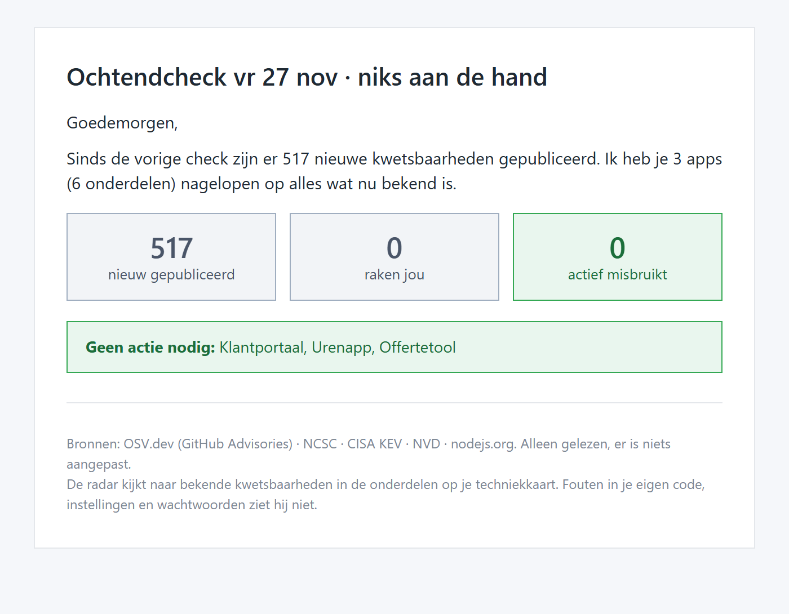

# Kwetsbaarheden-radar

[](https://github.com/Pilex-B-V/kwetsbaarheden-radar/actions/workflows/test.yml)
[](https://github.com/Pilex-B-V/kwetsbaarheden-radar/actions/workflows/ochtendcheck.yml)


[](LICENSE)

**Elke ochtend één mail: welke nieuwe kwetsbaarheden raken jouw apps, hoe erg is
het en welke update lost het op.**

Een app die je met Claude, Lovable of een bureau hebt laten bouwen, bestaat uit
honderden onderdelen van anderen. In die onderdelen worden elke dag nieuwe
lekken gevonden. De radar legt de onderdelen van jouw apps elke ochtend naast
zeven openbare bronnen en mailt je wat hij vindt. Meestal is dat: niks aan de
hand.

| Meestal | Als het raak is |
| --- | --- |
|  |  |

- **Eén mail, rond 08:00.** Wat is er nieuw, wat raakt jou, wat wordt actief
  misbruikt.
- **Per lek een oplossing.** Naar welke versie je moet en hoeveel werk dat
  ongeveer is.
- **Een instructie voor je developer.** Per app de exacte opdrachten, klaar om
  door te sturen.
- **Zeven openbare bronnen.** OSV.dev met de GitHub Advisory Database, NVD, CISA
  KEV, EUVD, EPSS, het NCSC en nodejs.org.
- **Alleen lezen.** De radar past niets aan in je apps.
- **Geen afhankelijkheden.** Eén programma in Node.js, zonder pakketten van
  derden. Je kunt elke regel nalezen.

De achtergrond, een invulhulp voor de techniekkaart en alle prompts staan in de
gratis gids van Pilex:
[pilex.ai/kwetsbaarheden-radar](https://www.pilex.ai/kwetsbaarheden-radar).

## Inhoud

- [Zo werkt het](#zo-werkt-het)
- [In vijf stappen aan de praat](#in-vijf-stappen-aan-de-praat)
- [Op je eigen computer](#op-je-eigen-computer)
- [De techniekkaart](#de-techniekkaart)
- [Wat er in de mail staat](#wat-er-in-de-mail-staat)
- [Instellingen](#instellingen)
- [Wat de radar niet ziet](#wat-de-radar-niet-ziet)
- [Privacy en veiligheid](#privacy-en-veiligheid)
- [Veelgestelde vragen](#veelgestelde-vragen)
- [Hulp nodig](#hulp-nodig)

## Zo werkt het

```text
techniekkaart.json          openbare bronnen               je postvak
┌──────────────────┐        ┌──────────────────┐        ┌──────────────────┐
│ Klantportaal     │        │ OSV.dev, NVD     │        │ Ochtendcheck     │
│  next 15.2.2     │──────> │ CISA KEV, EUVD   │──────> │ 1 lek raakt je   │
│  Node.js 22.11.0 │ naam + │ EPSS, NCSC       │  mail  │ app. Update naar │
│ Urenapp, ...     │ versie │ nodejs.org       │        │ 15.5.29.         │
└──────────────────┘        └──────────────────┘        └──────────────────┘
```

1. Op de **techniekkaart** staat per app waar hij van gemaakt is. Die maak je
   één keer. De volledige lijst met onderdelen leest de radar zelf uit het
   lockfile van je app: het bestand waarin elk onderdeel met zijn versie staat.
2. Elke ochtend vraagt de radar bij de **bronnen** na welke bekende
   kwetsbaarheden er zijn voor precies jouw versies.
3. Hij maakt er **één mail** van en verstuurt die vanuit een postvak in Outlook.

De radar draait als dagelijkse taak in GitHub Actions, in je eigen, afgeschermde
kopie van deze repository. Er zit geen taalmodel in: vergelijken is rekenwerk en
hoort elke dag dezelfde uitkomst te geven.

## In vijf stappen aan de praat

Alles hieronder doe je in de browser. Je hoeft niets te installeren. Je hebt een
GitHub-account nodig, en voor de mail in Outlook een beheerder van Microsoft
365. Reken op een uur voor de eerste app.

Liever met hulp? De prompt in
[prompts/03-radar-installeren.md](prompts/03-radar-installeren.md) laat Claude
Code de stappen met je doorlopen.

### 1. Maak je eigen, afgeschermde kopie

Klik bovenaan deze pagina op **Use this template** en dan op **Create a new
repository**. Kies een naam, zet de zichtbaarheid op **Private** en maak de repository aan
met de groene knop onderaan.

> [!IMPORTANT]
> Je techniekkaart en je rapporten laten zien waar je apps kwetsbaar zijn. Die
> horen niet in een openbare repository. De taak weigert te draaien als er een
> techniekkaart in een openbare repository staat.

### 2. Bekijk het voorbeeld

Ga in je kopie naar **Actions**, klik links op **Ochtendcheck** en dan rechts op
**Run workflow**. Zolang er geen techniekkaart in je kopie staat, controleert de
radar drie verzonnen apps met bewust oude onderdelen. Er wordt niets verstuurd.

Klik na een halve minuut op de run die verschijnt. Onder **Summary** staat het
rapport, en onder **Artifacts** de mail zoals hij verstuurd zou worden. Hoe dat
eruitziet, staat ook in [voorbeeld/uitvoer](voorbeeld/uitvoer).

### 3. Maak je techniekkaart

Klik in je kopie op **Add file** en dan op **Create new file**. Noem het bestand
`techniekkaart.json` en plak dit erin, met je eigen gegevens:

```json
{
  "apps": [
    {
      "naam": "Klantportaal",
      "doel": "Klanten bekijken hun facturen en documenten",
      "eigenaar": "Directie",
      "developer": "Extern bureau",
      "gevoeligheid": "hoog",
      "bereikbaar": "internet",
      "platform": [{ "naam": "nodejs", "versie": "22.11.0" }],
      "bronnen": [
        { "soort": "github", "repo": "jouw-bedrijf/klantportaal", "pad": "package-lock.json" }
      ]
    }
  ]
}
```

Klik op **Commit changes...** en bevestig. Een tweede app zet je als volgend blok
in de lijst `apps`, met een komma ertussen. Wat elk veld betekent, staat bij
[De techniekkaart](#de-techniekkaart).

Bij `bronnen` staat waar het lockfile van de app staat. De radar haalt het elke
ochtend op, dus de kaart klopt ook nadat de app is bijgewerkt. Daarvoor heeft
hij een token nodig dat alleen mag lezen:

1. Klik rechtsboven op je profielfoto en ga naar **Settings**, **Developer
   settings**, **Personal access tokens**, **Fine-grained tokens**. Klik op
   **Generate new token**.
2. Kies bij **Expiration** een einddatum en zet die in je agenda. Daarna leest
   de radar je lockfiles niet meer; de mail zegt het als dat gebeurt.
3. Kies bij **Resource owner** de eigenaar van de repositories van je apps:
   jezelf of je organisatie.
4. Kies bij **Repository access** voor **Only select repositories** en selecteer
   alleen de repositories van je apps.
5. Zet bij **Permissions** alleen **Contents** op **Read-only**. Klik op
   **Generate token** en kopieer het token.
6. Ga in je kopie van de radar naar **Settings**, **Secrets and variables**,
   **Actions**. Klik op **New repository secret**, vul bij **Name**
   `RADAR_GITHUB_TOKEN` in, plak het token bij **Secret** en klik op **Add
   secret**.

Hoort de repository bij een organisatie, dan kan de eigenaar daarvan goedkeuring
eisen. Het token werkt dan pas nadat het is goedgekeurd.

Staat de code van je app niet in GitHub, of weet je niet waar hij van gemaakt
is? Zie [Op je eigen computer](#op-je-eigen-computer) en de prompts in
[prompts/](prompts/).

### 4. Koppel je mail

Volg [docs/outlook-instellen.md](docs/outlook-instellen.md). Een beheerder van
Microsoft 365 maakt één keer een koppeling die alleen vanuit één postvak mag
versturen. Dat levert vijf waarden op, die je als secret in je kopie zet.

Geen beheerder bij de hand? Sla deze stap dan voorlopig over. De radar draait
ook zonder mail: het rapport staat dan elke ochtend bij de run in GitHub.

### 5. Start de ochtendcheck

Ga naar **Actions**, klik links op **Ochtendcheck** en dan op **Run workflow**.
Na een paar minuten staat de eerste mail in je postvak. Daarna start de taak
elke ochtend om 07:40 Nederlandse tijd, zodat de mail er meestal voor 08:00 is.
Bij drukte kan GitHub een taak later starten.

De eerste mail is je nulmeting: alles wat nu open staat. Bij een app die een
tijd niet is bijgewerkt, is dat een lange lijst. Vanaf de tweede mail staat bij
elk lek of het nieuw is, of sinds wanneer het open staat.

## Op je eigen computer

Dit hoeft niet, maar het is handig als je de kaart wilt testen voordat je iets
verstuurt, of als de code van een app niet in GitHub staat. Je hebt Git en
Node.js 20 of hoger nodig. Pakketten installeren hoeft niet.

```bash
git clone https://github.com/<jouw-account>/<jouw-kopie>.git
cd <jouw-kopie>
npm run voorbeeld
```

De mail van het voorbeeld staat daarna in `uit/ochtendmail.html`.

**Een app op de kaart zetten vanuit een lockfile op je computer.** De radar leest
het lockfile één keer in en zet alle onderdelen in de kaart:

```bash
node src/kaart.mjs ../klantportaal/package-lock.json --naam "Klantportaal" --schrijf
```

Doe dit opnieuw na elke update van de app, anders loopt de kaart achter. Haalt
de radar het lockfile zelf op uit GitHub (stap 3), dan hoeft dit niet.

**De kaart testen zonder iets te versturen.**

```bash
node src/radar.mjs --droog
```

Een droge run doet alles, maar verstuurt en onthoudt niets. Haalt de radar je
lockfiles uit GitHub, dan heeft hij ook lokaal het token nodig, als
omgevingsvariabele `RADAR_GITHUB_TOKEN`.

## De techniekkaart

Eén bestand, `techniekkaart.json`, met per app:

| Veld | Wat je invult |
| --- | --- |
| `naam` | Hoe jullie de app noemen. Staat in de mail. Verplicht |
| `doel` | Wat mensen ermee doen, in één zin |
| `eigenaar` | Wie in het bedrijf erover gaat |
| `developer` | Wie de update uitvoert: een collega, een bureau of je IT-partner |
| `gevoeligheid` | `hoog` als er persoons-, klant- of financiële gegevens in staan, anders `normaal` of `laag` |
| `bereikbaar` | `internet` of `intern` |
| `platform` | Wat eronder draait, met de versie |
| `bronnen` | Waar het lockfile staat |
| `onderdelen` | Onderdelen die je zelf vastlegt, of die `src/kaart.mjs` erin zet |

Alleen `naam` is verplicht. `gevoeligheid` (standaard `normaal`) en `bereikbaar`
(standaard `internet`) bepalen mee hoe dringend een lek is. Een uitgewerkt
voorbeeld staat in [voorbeeld/techniekkaart.json](voorbeeld/techniekkaart.json).

**Bronnen.** Een bron is van de soort `github` of `bestand`:

```json
{ "soort": "github", "repo": "jouw-bedrijf/klantportaal", "pad": "package-lock.json" }
{ "soort": "bestand", "pad": "kaarten/klantportaal/package-lock.json" }
```

Bij `github` kun je met `"ref": "naam-van-de-branch"` een andere branch kiezen
dan de standaardbranch. Bij `bestand` is het pad relatief aan de kaart.

**Lockfiles.** De radar herkent het bestand aan de naam:

| Bestand | Van | Goed om te weten |
| --- | --- | --- |
| `package-lock.json`, `npm-shrinkwrap.json` | npm, ook bij Lovable en Bolt | |
| `pnpm-lock.yaml` | pnpm | |
| `bun.lock` | Bun | Staat er alleen een `bun.lockb`, draai dan één keer `bun install --save-text-lockfile` |
| `yarn.lock` | Yarn | Legt niet vast welke onderdelen alleen voor ontwikkeling zijn. De radar telt ze allemaal als deel van de live app |
| `requirements.txt` | Python | Alleen regels met een vaste versie (`naam==1.2.3`) |
| `composer.lock` | PHP | |

**Platform.** Wat onder de app draait, staat niet in het lockfile. Zet het er
zelf bij. De radar kent deze namen: `nodejs`, `postgresql`, `mysql`, `mariadb`,
`redis`, `mongodb`, `php`, `python`, `wordpress`, `drupal` en `apache`.

```json
"platform": [
  { "naam": "nodejs", "versie": "22.11.0" },
  { "naam": "postgresql", "versie": "16.4" }
]
```

Voor iets anders zet je de naam erbij die NVD ervoor gebruikt, in de vorm
leverancier en product: `{ "naam": "nginx", "versie": "1.27.0", "cpe": "f5:nginx" }`.
Een platformonderdeel dat de radar niet kent, slaat hij niet stil over: de app
staat dan in de mail onder Niet volledig gecontroleerd.

## Wat er in de mail staat

- **Drie getallen.** Hoeveel kwetsbaarheden er wereldwijd zijn gepubliceerd
  sinds de vorige check, hoeveel daarvan jouw apps raken en hoeveel er actief
  worden misbruikt.
- **Nu oppakken.** Alles met het advies vandaag of deze week. Per onderdeel de
  ernst, wat een aanvaller ermee kan, de versie die het oplost en een indicatie
  van het werk.
- **Minder dringend.** De rest, als tabel.
- **Geen actie nodig.** De apps die volledig zijn gecontroleerd en waar niets
  mee is.
- **Niet volledig gecontroleerd.** Apps waarvan een deel niet kon worden
  nagekeken, bijvoorbeeld omdat een lockfile niet te lezen was. Onder Let op
  staat waarom.
- **Voor je developer.** Per app een instructie met de exacte opdrachten.

Twee regels die je bij een lek kunt tegenkomen:

- **Komt mee met express.** Het onderdeel heb je niet zelf gekozen: het hangt
  onder een onderdeel dat je wel hebt gekozen. Vaak is dat bijwerken de
  eenvoudigste oplossing. De radar leest dit uit `package-lock.json` en
  `bun.lock`.
- **Kan de nieuwe hoofdversie niet meteen: 5.4.21 lost 15 van de 23 meldingen
  op.** De volledige oplossing vraagt een nieuwe hoofdversie, en dat is meer
  werk. Dit is de kleinere stap die je intussen kunt zetten.

Hoe de radar de ernst, het advies en de herstelversie bepaalt, staat in
[docs/hoe-het-werkt.md](docs/hoe-het-werkt.md). Voorbeelden van de mail, het
rapport en de instructie staan in [voorbeeld/uitvoer](voorbeeld/uitvoer).

## Instellingen

Alles stel je in met secrets en variabelen in je kopie: **Settings**, **Secrets
and variables**, **Actions**.

| Naam | Soort | Waarvoor |
| --- | --- | --- |
| `RADAR_GITHUB_TOKEN` | Secret | Leestoegang tot de repositories van je apps |
| `RADAR_TENANT_ID` | Secret | Outlook: het nummer van je Microsoft 365-omgeving |
| `RADAR_CLIENT_ID` | Secret | Outlook: het nummer van de app-registratie |
| `RADAR_CLIENT_SECRET` | Secret | Outlook: het wachtwoord van de app-registratie |
| `RADAR_MAIL_VAN` | Secret | Outlook: het postvak waaruit de mail vertrekt |
| `RADAR_MAIL_AAN` | Secret | Outlook: wie de mail krijgt, gescheiden door komma's |
| `RADAR_WEBHOOK_URL` | Secret | In plaats van Outlook: het adres waar de mail als JSON heen gaat |
| `NVD_API_KEY` | Secret | Optioneel. Met een gratis sleutel van NVD gaat het nalopen van platformonderdelen sneller |
| `RADAR_ALLEEN_BIJ_NIEUWS` | Variabele | Optioneel. Zet op `ja` om alleen een mail te krijgen als er iets nieuws is |
| `RADAR_TIJDZONE` | Variabele | Optioneel. De tijdzone voor de datum in de mail, standaard `Europe/Amsterdam` |

Een variabele maak je op hetzelfde scherm, op het tabblad **Variables**.

Ons advies: laat de mail elke dag komen, ook als er niets is. Een mail die
wegblijft, valt dan op.

Het tijdstip staat in
[.github/workflows/ochtendcheck.yml](.github/workflows/ochtendcheck.yml). Wil je
alleen werkdagen, verander dan `40 7 * * *` in `40 7 * * 1-5`.

**Zonder GitHub draaien.** De radar is één programma. Je kunt hem ook op een
eigen server laten draaien, met cron of de Taakplanner van Windows:
`node src/radar.mjs --kaart /pad/naar/techniekkaart.json`. De instellingen zet
je dan als omgevingsvariabelen bij die taak.

## Wat de radar niet ziet

De radar kijkt naar bekende, openbaar gemelde kwetsbaarheden in de onderdelen op
je kaart. Hij ziet niet:

- fouten in je eigen code, zoals een pagina die niet is afgeschermd;
- instellingen, zoals een open database of een sleutel in de code;
- onderdelen die niet op de kaart staan;
- lekken die nog niet openbaar zijn gemeld;
- of een lek in jouw app ook echt te misbruiken is.

Het is dus geen beveiligingstest. Het is de dagelijkse controle die ervoor zorgt
dat je een bekend lek in een onderdeel niet mist.

## Privacy en veiligheid

- **Wat er naar buiten gaat.** De radar stuurt per onderdeel alleen ecosysteem,
  naam en versie naar OSV.dev, en de naam en versie van platformonderdelen naar
  NVD. Van de meldingen die hij vindt, stuurt hij het nummer naar EPSS en EUVD
  om er de kans op misbruik bij te zoeken. De namen van je apps, je code en je
  gegevens verlaten je omgeving niet.
- **Wat hij mag.** De taak heeft in GitHub alleen leesrechten. Het token mag
  alleen lezen, in de repositories die jij aanwijst; de radar haalt er alleen
  het lockfile mee op. De koppeling met Outlook mag alleen versturen, en alleen
  vanuit één postvak.
- **Wat hij bewaart.** In de map `.radar` staat welke meldingen hij al zag. De
  mail en het rapport van elke run blijven 14 dagen als bijlage bij de run
  staan, en het rapport staat ook in de samenvatting van de run. Alleen wie bij
  je afgeschermde repository kan, ziet dat.
- **Geen pakketten van derden.** De radar gebruikt alleen wat in Node.js zit. De
  acties in de taak staan vast op een commit, niet op een versienaam.
- **Tekst uit bronnen is tekst.** Alles wat uit een melding komt, wordt
  onschadelijk gemaakt voordat het in de mail staat.

Een kwetsbaarheid in de radar zelf meld je volgens [SECURITY.md](SECURITY.md).

## Veelgestelde vragen

**Ik krijg bij de eerste run een lange lijst. Wat nu?**
Dat is normaal bij een app die een tijd niet is bijgewerkt. Begin bij Nu
oppakken. Eén update lost vaak tientallen meldingen tegelijk op. De prompt in
[prompts/06-nulmeting-opruimen.md](prompts/06-nulmeting-opruimen.md) maakt er
een plan van.

**Hoe weet ik dat de radar nog werkt?**
Doordat je elke ochtend een mail krijgt, ook als er niets is. Geeft een bron
geen antwoord, dan staat dat onderaan de mail. Mislukt de run zelf, dan is hij
onder **Actions** rood en stuurt GitHub daar een melding over, als je
meldingen voor Actions aan hebt staan.

**Klopt wat de radar vindt?**
Voor npm vindt de radar dezelfde kwetsbare onderdelen als `npm audit`: beide
gebruiken de GitHub Advisory Database. De radar voegt eraan toe of een lek
actief wordt misbruikt, legt je apps naast elkaar en kijkt ook naar het
platform eronder.

**Mijn app is gebouwd met Lovable. Werkt dit?**
Ja, als de code in GitHub staat en er een `package-lock.json` of `bun.lock` in
zit. Staat de code nog niet in GitHub, koppel het project dan eerst aan GitHub.

**Kan ik de radar voor meer bedrijven of klanten gebruiken?**
Ja. Maak per klant een eigen kopie, zodat de gegevens gescheiden blijven.

**Kost dit iets?**
De radar en alle bronnen zijn gratis. Eén korte taak per dag in een
afgeschermde repository valt ruim binnen wat een gratis GitHub-account elke
maand aan rekentijd krijgt.

**Hoe neem ik verbeteringen van de radar over?**
Je kopie staat los van deze repository. Kopieer de nieuwe versie van de map
`src` en van `.github/workflows` naar je kopie. Wat er is veranderd, staat bij
[Releases](https://github.com/Pilex-B-V/kwetsbaarheden-radar/releases).

## Ontwikkelen

```bash
npm test
```

De tests draaien zonder internet: de bronnen worden nagespeeld. Verbeteringen
zijn welkom via een pull request.

## Hulp nodig

De radar is gemaakt door [Pilex](https://www.pilex.ai). Wij helpen bedrijven AI
en eigen software veilig in te zetten en te beheren.

- De gids met alle stappen en prompts: [pilex.ai/kwetsbaarheden-radar](https://www.pilex.ai/kwetsbaarheden-radar)
- Wil je dat wij de radar inrichten, of het beheer van je apps overnemen?
  [Plan een gesprek van 30 minuten](https://calendly.com/d/cvtm-dkz-ncx/ontdekkingsgesprek-pilex-cas)

## Licentie

[MIT](LICENSE). Gebruik het, pas het aan, deel het.
